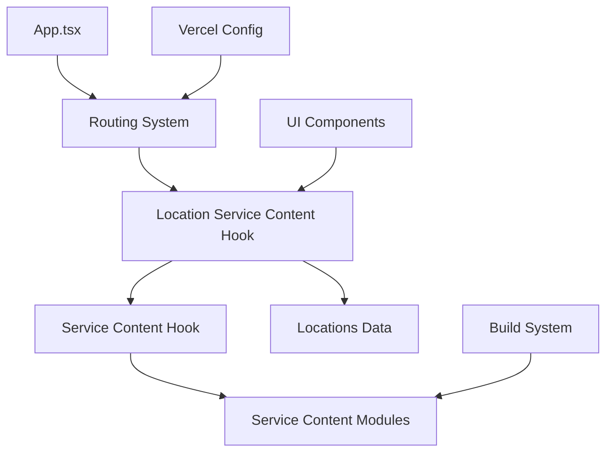

# AI Implementation Guide for Agape Plumbing Project

## Critical AI Agent Protocol

**MANDATORY**: Before ANY modification, consult the Project Brain analysis and follow the established protocol.

### Pre-Implementation Checklist
- [ ] Read current project health score (target: >9.0)
- [ ] Identify affected nodes in the project graph
- [ ] Review change management rules for the specific area
- [ ] Validate against location-service architecture constraints
- [ ] Check bundle size impact (<10% increase allowed)

## Architecture Understanding

### Core Patterns

1. **Location-Centric Design**
   - All content is customizable by location
   - URLs follow `/services/{location}/{service}` pattern
   - SEO optimization is location-aware

2. **Hook-Based Content Management**
   - `useLocationServiceContent`: Location-aware content with SEO
   - `useServiceContent`: Base service content loading
   - `useContent`: Legacy content system (being phased out)

3. **Dynamic Routing System**
   - Multi-parameter routes with validation
   - SPA routing via Vercel configuration
   - Automatic 404 handling for invalid combinations

### Critical Dependencies



## Implementation Patterns

### Adding New Locations

**Step 1**: Update `src/content/locations.ts`
```typescript
export const locations = {
  // ... existing
  "new-location": {
    slug: "new-location",
    name: "New Location",
    fullName: "New Location, State",
    county: "County Name",
    neighborhoods: ["Area 1", "Area 2"],
    landmarks: ["Landmark 1", "Landmark 2"],
    commonIssues: ["Issue 1", "Issue 2"],
    serviceAreas: ["Service Area 1", "Service Area 2"]
  }
};
```

**Validation**: Location automatically integrates with:
- `getLocationBySlug()` function
- `useLocationServiceContent` hook
- SEO meta tag generation
- Areas page listing

### Adding New Routes

**Step 1**: Update `src/App.tsx`
```typescript
import { NewComponent } from './pages/NewComponent';

// Add to Routes
<Route path="/new-route" element={<NewComponent />} />
<Route path="/new-route/:param" element={<NewComponent />} />
```

**Step 2**: Update `vercel.json`
```json
{
  "rewrites": [
    {
      "source": "/new-route",
      "destination": "/index.html"
    },
    {
      "source": "/new-route/:param",
      "destination": "/index.html"
    }
  ]
}
```

**Step 3**: Create component with proper SEO
```typescript
import { Helmet } from 'react-helmet-async';
import { useParams } from 'react-router-dom';

export function NewComponent() {
  const { param } = useParams();
  
  return (
    <>
      <Helmet>
        <title>Page Title | Agape Plumbing</title>
        <meta name="description" content="SEO description" />
        <link rel="canonical" href={`https://agapeplumbing.com/new-route${param ? `/${param}` : ''}`} />
      </Helmet>
      
      <div className="min-h-screen bg-white">
        {/* Content */}
      </div>
    </>
  );
}
```

### Location-Service Pages

**Pattern**: Use `useLocationServiceContent` hook
```typescript
import { useLocationServiceContent } from '../hooks/use-location-service-content';

export function LocationServicePage() {
  const { location, serviceSlug } = useParams();
  const { content, loading, error } = useLocationServiceContent(location, serviceSlug);
  
  if (loading) return <LoadingSpinner />;
  if (error) return <ErrorBoundary error={error} />;
  
  return (
    <>
      <Helmet>
        <title>{content.title}</title>
        <meta name="description" content={content.description} />
        <link rel="canonical" href={content.canonicalUrl} />
        <meta property="og:title" content={content.title} />
        <meta property="og:description" content={content.description} />
      </Helmet>
      
      {/* Page content using content object */}
    </>
  );
}
```

## Content Hook Usage

### useLocationServiceContent
**Purpose**: Location-aware content with SEO optimization
**Returns**: `{ content, loading, error }`
**Content Structure**:
```typescript
{
  title: string,
  description: string,
  canonicalUrl: string,
  hero: { title, subtitle, description },
  services: ServiceItem[],
  whyChooseUs: { title, items },
  serviceAreas: { title, areas },
  emergencyCTA: { title, description, phone }
}
```

### useServiceContent
**Purpose**: Base service content loading
**Returns**: `{ content, loading, error }`
**Usage**: For non-location-specific service pages

## UI Component Patterns

### Consistent Styling
- Use Tailwind CSS classes
- Follow brutalist design system
- Maintain color scheme: white backgrounds, dark text
- Use shadcn/ui components when available

### Navigation Links
```typescript
// Location-service links
<Link to={`/services/${location.slug}/${service.slug}`}>
  {service.name} in {location.name}
</Link>

// Area links
<Link to={`/areas/${location.slug}`}>
  {location.name} Services
</Link>
```

### Loading States
```typescript
if (loading) {
  return (
    <div className="min-h-screen bg-white flex items-center justify-center">
      <div className="animate-spin rounded-full h-8 w-8 border-b-2 border-black"></div>
    </div>
  );
}
```

### Error Handling
```typescript
if (error) {
  return (
    <div className="min-h-screen bg-white flex items-center justify-center">
      <div className="text-center">
        <h1 className="text-2xl font-bold mb-4">Content Not Found</h1>
        <p className="text-gray-600 mb-4">The requested content could not be loaded.</p>
        <Link to="/" className="text-blue-600 hover:underline">Return Home</Link>
      </div>
    </div>
  );
}
```

## SEO Implementation

### Required Meta Tags
```typescript
<Helmet>
  <title>{locationSpecificTitle} | Agape Plumbing</title>
  <meta name="description" content={locationSpecificDescription} />
  <link rel="canonical" href={canonicalUrl} />
  <meta property="og:title" content={title} />
  <meta property="og:description" content={description} />
  <meta property="og:url" content={canonicalUrl} />
  <meta property="og:type" content="website" />
</Helmet>
```

### URL Structure
- Use hyphens for word separation
- Keep URLs descriptive but concise
- Include location and service identifiers
- Maintain consistency across similar pages

## Testing Protocol

### Development Testing
1. **Route Functionality**
   ```bash
   bun dev
   # Test: http://localhost:5173/new-route
   # Test: http://localhost:5173/new-route/parameter
   ```

2. **Content Loading**
   - Verify hook returns expected data
   - Test loading states
   - Test error states
   - Validate SEO meta tags

3. **Navigation**
   - Test links from other pages
   - Test browser back/forward
   - Test direct URL access

### Production Testing
1. **Deployment Verification**
   ```bash
   # After deployment
   curl -I https://agapeplumbing.com/new-route
   # Should return 200, not 404
   ```

2. **SEO Validation**
   - Check meta tags in browser dev tools
   - Validate canonical URLs
   - Test social media sharing

## Performance Considerations

### Bundle Size
- Monitor bundle size impact (<10% increase)
- Use dynamic imports for large components
- Implement code splitting for service modules

### Loading Performance
- Implement proper loading states
- Use skeleton UI components
- Optimize image loading

### SEO Performance
- Generate location-specific meta tags
- Implement proper canonical URLs
- Use structured data when applicable

## Common Pitfalls

### 1. Missing Vercel Configuration
**Problem**: Route works in development but 404 in production
**Solution**: Add rewrite rule to `vercel.json`

### 2. Invalid Location Slugs
**Problem**: Content hook returns error
**Solution**: Validate location exists in `locations.ts`

### 3. SEO Meta Tags Missing
**Problem**: Poor search engine visibility
**Solution**: Always include Helmet with proper meta tags

### 4. Inconsistent URL Patterns
**Problem**: Confusing navigation and SEO issues
**Solution**: Follow established URL patterns

### 5. Bundle Size Increase
**Problem**: Performance degradation
**Solution**: Use dynamic imports and code splitting

## Project Health Monitoring

### Health Score Factors
- **Architecture Integrity**: Maintain location-centric design
- **Performance**: Bundle size, loading times
- **SEO Optimization**: Meta tags, canonical URLs
- **Code Quality**: TypeScript compliance, error handling
- **Testing Coverage**: Development and production testing

### Risk Assessment
- **High Risk**: Changes to routing system, content hooks
- **Medium Risk**: New page components, UI modifications
- **Low Risk**: Content updates, styling changes

## Update Protocol

After implementing changes:

1. **Update Project Brain**
   - Recalculate health score
   - Document new risks or optimizations
   - Update node metadata

2. **Test Thoroughly**
   - Development environment
   - Production deployment
   - SEO validation

3. **Document Changes**
   - Update relevant guides
   - Add to change history
   - Note lessons learned

## Emergency Procedures

### Rollback Process
1. Identify problematic changes
2. Revert to last known good state
3. Test functionality
4. Update documentation

### Critical Issues
- Health score drops below 8.0
- Bundle size increases >10%
- SEO meta tags broken
- Routing system failures

## AI-Specific Guidelines

1. **Always Reference Project Brain**: Understand current state before changes
2. **Follow Established Patterns**: Don't reinvent existing solutions
3. **Validate Thoroughly**: Test both development and production
4. **Document Changes**: Update guides and analysis
5. **Maintain Health Score**: Target >9.0 overall health
6. **Respect Architecture**: Don't break location-centric design
7. **Optimize Performance**: Monitor bundle size and loading times

This guide ensures consistent, high-quality implementations that maintain the project's sophisticated architecture and performance standards.